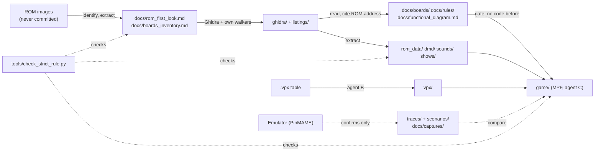

# Standard layout of a decoding repository

*Résumé (FR).* Jusqu'ici, aucun fichier de ce dépôt ne fixait l'arborescence d'un dépôt de décodage : chaque jeu a grandi à sa façon (Tron / Transformers sur SAM, LOTR sur Whitestar, T2 et Medieval Madness sur WPC). Ce document la fixe, d'après ce qui a fonctionné, avec une table d'écarts par dépôt (section 4). Elle est vérifiée par `tools/strict_rule/check_strict_rule.py` (section 5). Les dépôts existants ne sont pas réorganisés sans l'accord de Vincent.

**Scope.** One decoding repository per game (agent A's asset repo, plus B's `vpx/` output, plus the game's `game/` folder when C works in the same repo, as on the private LOTR and T2 repositories). Same layout for SAM (ARM7), WPC and Whitestar (6809): only the file names inside `ghidra/` and `listings/` change with the CPU. Game-agnostic methods stay in this repository; **game facts stay in the game's repository**.

Two principles decide where a file goes:

1. **Source of the fact.** What was decoded from the code goes in `docs/`, `rom_data/`, `dmd/`, `sounds/`, `shows/` with its ROM address. What was observed in an emulator (PinMAME) goes **only** in `traces/` and `docs/captures/`, and only confirms (STRICT RULE, item 4). Nothing in `rom_data/` or `game/` may declare a capture as its source unless `docs/pinmame_waivers.md` lists it.
2. **Kind of file.** Prose and diagrams in `docs/`, machine-readable tables in `rom_data/`, scripts in `tools/`, outputs of Ghidra in `ghidra/`, disassembly in `listings/`. A file is never in two places: `rom_data/` wins over older prose.

## 1. The tree

```
<Game>-Decryption/
├── CLAUDE.md               strict rule text (markers checked), read order, language of reports
├── README.md               game, ROM set + version, read order, deliverable status table
├── .gitignore              ROM patterns (*.rom *.zip *.bin *.nv, board file names), rom/, work/
├── rom/                    LOCAL ONLY, ignored. Optional versioned: rom/manifest.csv (name, size, sha256, board)
│
├── docs/
│   ├── boards_inventory.md      STEP ZERO. Every board with its own CPU/MCU/ROM, state complet/partiel/absent
│   ├── rom_first_look.md        identification, memory map summary, OS conventions, first findings
│   ├── memory_map.md            address map of every CPU (banks, I/O, RAM)
│   ├── ghidra.md                how the decompile was produced and re-run (seeds, signatures, labels)
│   ├── functional_diagram.md    whole-machine diagram from the code, one ROM address per node (+ .mmd source, .svg render)
│   ├── flow/                    OR the diagram split per subsystem (boot, game_flow, service, modes), same rule
│   ├── boards/<board>.md        one page per independent board: firmware, interface to the CPU, packets/commands
│   │                            (+ <board>.mmd / .svg diagram beside it)
│   ├── rules/                   one spec per feature, from the code (README.md index first; template: knowledge/templates/)
│   ├── captures/                observed notes (confirm-only), never a source of rules
│   ├── pinmame_waivers.md       only if the owner approved a capture-sourced datum: `path` approved by Vincent <date>
│   └── rom_exceptions.md        only if the owner approved a ROM-like file in the repo: `path` approved by Vincent <date>
│
├── ghidra/                 OUTPUT of the decompile: <game>_<cpu>.c per CPU/bank set, labels.csv, signatures
├── listings/               labelled disassembly per board (.asm / .lst): the cross-check of ghidra/
├── rom_data/               machine-readable tables (CSV/JSON), one README.md index (area, file, what, source tag)
│   ├── README.md           REQUIRED: every file, with source tag code / observed / inferred
│   ├── (flat by area is fine; subfolders io/ settings/ audit/ display/ sound/ for large games)
│   └── <model>/            a second model of the same game (Pro / LE), as rom_data/pro/ on Tron
├── dmd/                    display data decoded from the ROM: fonts, objects, effect scripts, screens (small text/PNG)
├── sounds/                 sound index and command tables decoded from the firmware (audio files only if the repo is private)
├── shows/                  lamp / flasher shows decoded from the ROM (leffs)
├── vpx/                    agent B output: monitor.yaml, switch/lamp/flasher CSV, script.vbs (playfield.png if small)
├── traces/                 reference traces from the emulator, CONFIRM ONLY (one folder per scenario)
├── scenarios/              the scenario scripts that produce the traces
│
├── tools/
│   ├── check_strict_rule.py     copy of tools/strict_rule/check_strict_rule.py
│   ├── ghidra/                  export / setup scripts, run_ghidra.sh, seeds, signatures
│   ├── audit/ dmd/ sound/ flow/ extractors per area (flat is fine for a small game)
│   └── emu/ (or pinmame/)       emulator patches and capture harness: only produce traces/
├── tests/                  pytest / unittest on the tools and the tables
├── scripts/                install and run kit (agent F), only when it lives in this repository
├── .github/workflows/      CI (default branch + manual only)
│
└── game/                   MPF game (agents C to G), ONLY after docs/functional_diagram.md exists
    ├── config/ modes/ shows/ monitor/ pup/ sound/ tests/ docs/   (layout owned by MPF-Godot-Packaging)
    └── media/              derived media: private repository only, never in a public one
```

Visual (GitHub renders it):



## 2. Rules of the layout

- **Boards.** `docs/boards_inventory.md` first (template `knowledge/templates/boards_inventory.md`). Each row is a board with its own CPU, MCU, ROM or firmware: main CPU, DMD controller, sound board, and any other (power driver with a processor, display driver, I/O expander). Each row points to its `docs/boards/<board>.md` and its `ghidra/` / `listings/` files. The CPU board's own page is `docs/rom_first_look.md` + `docs/rules/`.
- **Diagram.** `docs/functional_diagram.md` (or `docs/flow/`) holds the node list with a ROM address per node, a `.mmd` source and a `.svg` render. A node without an address is a defect. Each board page may add its own diagram beside it.
- **Specs.** `docs/rules/<feature>.md`, one per mode or feature, each with `README.md` as index; every claim carries a fact tag (code / observed / inferred) and the ROM address.
- **Tables.** One CSV/JSON per subject in `rom_data/`, every row with its ROM address. `rom_data/README.md` lists each file with its source tag. A table built from a capture is `observed`, lives in `traces/`, and cannot feed `game/`.
- **ROMs.** Never committed. `.gitignore` carries the patterns; `rom/` is a local, ignored folder. A hash-only `rom/manifest.csv` may be versioned (the manifest is not a ROM). A ROM-like file is allowed only when the owner approved it and `docs/rom_exceptions.md` says so.
- **Media.** Extracted images, WAVs and videos stay out of public repositories. In a private repository, large derived media stays under `game/media/` or `dmd/`, `sounds/`; in a public one, only the index tables.
- **`game/`.** Appears only after the diagram. Its own layout follows [MPF-Godot-Packaging](https://github.com/Ashram56/MPF-Godot-Packaging) (not defined here). Name it `game/`, not `mpf/`.
- **Names.** Lower-case, `snake_case` files, one folder per board named after the board (`dmd`, `sound`, `cpu`), one scenario per file.

## 3. What each agent writes where

| Agent | Writes in | Never in |
|---|---|---|
| A, step zero | `docs/boards_inventory.md`, `docs/rom_first_look.md`, `.gitignore`, `rom/manifest.csv` | |
| A, decompile | `ghidra/`, `listings/`, `docs/ghidra.md`, `docs/memory_map.md`, `docs/boards/` | `game/` |
| A, rules and diagram | `docs/functional_diagram.*` or `docs/flow/`, `docs/rules/`, `rom_data/`, `dmd/`, `sounds/`, `shows/` | traces as a source |
| A, confirmation | `traces/`, `scenarios/`, `docs/captures/`, `tools/emu/` | `rom_data/`, `game/` |
| B | `vpx/` | |
| C to G | `game/` (and `scripts/` for F) | `rom_data/` (ask A through the batched request) |

## 4. Correspondence table: existing repositories against the standard

State as read on 2026-11-26 (default or working branch). The SAM column comes from this repository's `rom_extraction.md` and the Tron repository was not readable in this session (`?` = not checked, ✗ = the file's own references show another place); LOTR, T2 and Medieval Madness were read in full. **Standard** column = this document; ✓ conforms, ✗ differs, – not applicable yet. No repository was changed; each gap is a proposal for Vincent to approve.

| Standard path | SAM (Tron, Transformers) | LOTR (Whitestar 6809) | T2 (WPC 6809) | Medieval Madness (WPC-95, in progress) |
|---|---|---|---|---|
| `CLAUDE.md` with rule markers | ? | ✗ working rules 6-7 not in the text (checker FAIL) | ✓ | ✓ |
| `README.md` read order | ✓ | ✓ | ✓ | ✓ (private, short) |
| `.gitignore` ROM patterns | ? (not read) | ✓ (`*.zip`, board file names, `rom/`; `*.rom` as well) | ✓ (`*.rom *.zip *.bin *.nv`) | ✓ |
| `docs/boards_inventory.md` | ✗ older repos predate the rule: add it | ✓ all rows `complet` | ✓ (sound board not decompiled: rule fails on purpose) | ✓ (2 boards `partiel`) |
| `docs/rom_first_look.md` | ✗ `README.md` + `docs/agent_notes/` | ✓ | ✓ | ✓ |
| `docs/memory_map.md` | ✗ in `rom_extraction.md` section 2 | ✓ | ✗ in `rom_first_look.md` | ✗ |
| `docs/ghidra.md` | ✗ `rules/tools/ghidra/README` | ✓ | ✗ | ✗ (`tools/run_ghidra.sh`) |
| `docs/functional_diagram.*` or `docs/flow/` | ✗ absent | ✓ `.md .mmd .svg` | ✗ absent (game/ exists: checker FAIL) | ✓ `docs/flow/boot.md` (started) |
| `docs/boards/<board>.md` | ✗ `io/bus/` | ✗ `docs/dmd/`, `docs/sound/`, `docs/dmd.md`, `docs/sound_hardware.md` | ✗ none | ✗ `docs/dsp_layout.md`, `docs/dsp_boot_kernel.md` |
| `docs/rules/` | ✗ `rules/` at top level | ✓ 29 specs | ✓ 9 specs | – |
| `docs/captures/` | ✗ | ✓ | – (`traces/`) | – |
| `ghidra/` (outputs) | ✗ `rules/tools/ghidra/` + exports | ✗ scripts in `tools/ghidra/`, no `ghidra/` output folder | ✓ `ghidra/t2_6809.c` | ✓ `ghidra/mm_6809.c` |
| `listings/` | ✗ | ✗ none (walk listings in `rom_data/audit_*`) | ✓ | ✓ (DSP) |
| `rom_data/` + `README.md` | ✓ (`rom_data/README.md`, `rom_data/pro/`) | ✓ flat, README with source tags | ✗ no README | ✗ no README |
| `traces/` + `scenarios/` | ✗ in `rom_data/` / `rules/` | ✗ `rom_data/traces/` (28), `scenarios/` ✓ | ✓ `traces/ex_*` (no `scenarios/`) | – |
| `dmd/`, `sounds/`, `shows/` | ✗ `mpf_package/` | ✗ DMD media in project files, `rom_data/dmd_*.csv` only | ✓ `dmd/`, `sounds/`, `shows/` | – |
| `vpx/` | – | ✗ `game/vpx/` | ✓ | – |
| `tools/` + `tools/check_strict_rule.py` | ✗ older | ✓ flat + subfolders, copy present | ✓ flat, copy present | ✓ flat, copy present |
| `tools/emu/` (capture harness) | – | ✗ `tools/pinmame/` (accepted alias) | ✓ `tools/emu/` | – |
| `scripts/` (install kit) | – | ✓ + `game/scripts/` duplicates | – | – |
| `game/` | ✗ `mpf_package/`, separate game repo | ✓ `game/` (5135 media files: private repo) | ✗ named `mpf/` (images, shows, sounds duplicate `dmd/ shows/ sounds/`) and `game/monitor` | – |
| ROMs not versioned | ✓ | ✓ | ✓ | ✓ |

**Main gaps to close, by priority** (none touches the other repositories before approval):

1. T2 `game/` has code but no diagram (strict-rule FAIL); T2 `mpf/` → `game/`; add `rom_data/README.md` there and in Medieval Madness.
2. LOTR: add the two working-rule markers to `CLAUDE.md`; move `rom_data/traces/` → `traces/`; `game/vpx/` → `vpx/`; one `docs/boards/` folder for the DMD and sound pages; add `ghidra/` for the decompile outputs.
3. T2, MM: add `docs/memory_map.md`, `docs/ghidra.md`; MM: rename its `docs/dsp_*` pages under `docs/boards/`.
4. SAM repos (Tron, Transformers) predate the rule: add `docs/boards_inventory.md`, expose the diagram, move `rules/` → `docs/rules/` only if Vincent wants; they remain the reference implementation of the method.

## 5. Checking it

`python tools/check_strict_rule.py .` (canonical copy `tools/strict_rule/check_strict_rule.py`) now also runs the layout checks:

- **FAIL** (always): a ROM-like file committed (`.rom .bin .zip .nv .7z .snd`, `.aNN`, `.uNN`, `.NNN`) not listed in `docs/rom_exceptions.md`.
- **WARN** (prefixed `layout:`): a top-level folder outside the standard (with the standard name when it is a known legacy one: `mpf/` → `game/`, `rules/` → `docs/rules/`), missing `README.md`, `docs/rom_first_look.md`, `rom_data/README.md`, `tools/`, missing ROM patterns in `.gitignore`, `rom_data/traces/`, `game/` without a diagram.
- `--layout-strict`: the `layout:` warnings become failures. Use it on every **new** game repository from its first commit; existing repositories migrate at the owner's pace.

Last updated 2026-11-26 (created from the SAM, Whitestar and WPC repositories).
